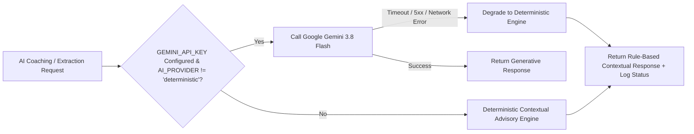
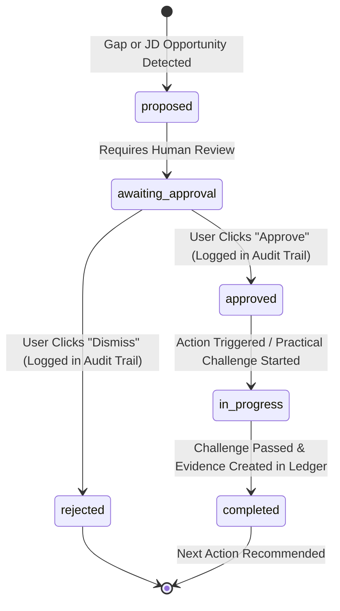

# SkillForge AI — System Architecture & Technical Specifications

> **Version:** 2.0 MVP  
> **Platform Target:** SaarthiX Jobs Hackathon 2026  
> **Repository:** [tanmayyyyayyy/SkillForge-AI](https://github.com/tanmayyyyayyy/SkillForge-AI)  
> **Live Deployment:** [https://skillforge-ai-q4tz.onrender.com](https://skillforge-ai-q4tz.onrender.com)

---

## 1. System Overview

SkillForge AI is an explainable career readiness intelligence platform. It bridges the gap between learner skills and employer expectations by analyzing target job requirements, identifying skill gaps, orchestrating human-in-the-loop autonomous career actions (Career Autopilot), verifying skills through server-authoritative practical proofs, recording verifiable evidence in a tamper-resistant canonical evidence ledger, and synthesizing a directed Evidence Graph with causal recommendation traces.

```mermaid
flowchart TD
    subgraph Client ["Frontend Layer (React 19 + TypeScript + Vite 8)"]
        UI_Dash[Mission Control & Dashboard]
        UI_Opp[Opportunity Match & JD Analyzer]
        UI_Auto[Career Autopilot & Decision Trail]
        UI_Proof[Skill Proof Lab & Assessments]
        UI_Graph[Evidence Graph & Provenance Viewer]
        UI_Twin[Career Twin & What-If Lab]
        UI_Exp[Readiness Experiment & Tracker]
    end

    subgraph Server ["Backend API Layer (Express 5 + TypeScript on Node.js)"]
        Router[REST API Router /api/*]
        AuthMid[JWT Authentication & Tenant Guard]
        
        subgraph Engines ["Core Intelligence & Decision Engines"]
            GapEng[Gap Engine: Priority = Gap × Weight]
            ReadEng[Readiness Engine: 50% Prof + 25% Proof + 25% Proj]
            AutoServ[Autopilot Service & Approval Governor]
            ProofServ[Skill Proof Lab Evaluator]
            GraphServ[Evidence Graph & Trace Synthesizer]
            WhatIfServ[What-If Simulation Engine]
            PdfServ[Server-Authoritative PDF 1.4 Generator]
        end

        subgraph AI_Layer ["AI & Advisory Layer"]
            GeminiClient[Google Gemini Client (gemini-3.8-flash)]
            DetFallback[Deterministic Contextual Advisory Engine]
            StatusMon[AI Provider Health & Diagnostics]
        end

        subgraph Persistence ["Data & Storage Layer"]
            Store[Transactional JSON Store (Atomic Writes)]
            DataJson[(server/db/data.json)]
        end
    end

    Client -->|HTTP/JSON + JWT Bearer| Router
    Router --> AuthMid
    AuthMid --> Engines
    Engines --> AI_Layer
    Engines --> Store
    Store --> DataJson
```

---

## 2. Frontend Architecture

### 2.1 Technology Stack
- **Framework:** React 19 (`react`, `react-dom`)
- **Language:** TypeScript 6 with strict typing
- **Build Tool:** Vite 8 with `@vitejs/plugin-react`
- **Routing:** React Router v7 (`react-router-dom`)
- **Iconography:** Lucide React (`lucide-react`)
- **Design System:** Pure Vanilla CSS with CSS custom properties (variables), glassmorphic dark-mode palette, and zero runtime CSS-in-JS overhead.

### 2.2 Component Hierarchy & Layout
- **Root Container (`src/App.tsx`):**
  - Wrapped in `AuthProvider` (session persistence via localStorage) and `ToastProvider` (system notifications).
  - Uses `Suspense` and `React.lazy` across all 24 page routes to maintain sub-500ms initial page load.
  - Global `ErrorBoundary` catches unexpected client errors without unmounting navigation.
  - Global `CommandPalette` (`Cmd+K` / `Ctrl+K`) for keyboard-driven navigation.
- **Layout Shell (`AppLayout`):**
  - Collapsible, mobile-responsive `Sidebar` navigation.
  - Sticky `DemoBanner` allowing 1-click evaluation resets.
  - Main scrollable content view (`.page-body`) with full desktop and mobile media query breakpoints.

### 2.3 Key Views & Modules
1. **Mission Control (`/mission-control` & `/dashboard`):** High-level readiness ring, target role tracking, quick actions, active skill alerts.
2. **Opportunity Match (`/opportunity-match`):** Real-time JD parsing, 4-quadrant alignment breakdown (Strong, Partial, Missing, Bonus), and 1-click "Add to Career Autopilot" integration.
3. **Career Autopilot (`/autopilot`):** Autonomous career progress board with human-in-the-loop approval gates and immutable Decision Audit Trail.
4. **Skill Proof Lab (`/proof-of-skill`):** Practical coding challenge IDE with automated test assertion evaluation and rubric scoring.
5. **Evidence Graph (`/evidence-graph`):** SVG interactive directed graph mapping Job Requirements &rarr; Required Skills &rarr; Recorded Evidence &rarr; Recommended Actions &rarr; Target Readiness.
6. **Career Twin What-If Lab (`/career-twin`):** Parameterized slider simulation (hours/week, project intensity, horizon) and pre-computed career evolution scenarios.
7. **Readiness Experiment (`/experiment`):** 9-stage guided live career readiness sprint.
8. **Job Description Analyzer (`/jd-analyzer`):** Verbatim quote-backed requirement extraction and catalog matching.
9. **Skill Assessments (`/assessments`):** Server-graded MCQ knowledge checks (9 skills covered).
10. **Learning Roadmap & Weekly Planner (`/roadmap`, `/weekly-planner`):** Dependency-ordered topological task progression and capacity-bounded weekly scheduling.

---

## 3. Backend Architecture

### 3.1 Technology Stack
- **Runtime:** Node.js (v18+) executed via `tsx`
- **Web Framework:** Express 5 (`express`)
- **Authentication:** JSON Web Tokens (`jsonwebtoken`) + Password Hashing (`bcryptjs`)
- **Cross-Origin Handling:** `cors` middleware with environment-configurable allowed origins

### 3.2 Service & Route Layout
Backend endpoints are strictly modularized under `server/routes/` and backed by isolated services in `server/services/` and `server/engine/`:

| Route Prefix | Responsible Module | Description |
| :--- | :--- | :--- |
| `/api/auth` | `server/routes/auth.ts` | Registration, login, demo 1-click session, demo data reset. |
| `/api/profile` | `server/routes/profile.ts` | Authenticated student profile CRUD and skills management. |
| `/api/careers` | `server/routes/careers.ts` | 8 industry-standard career role tracks with 10-14 skills each. |
| `/api/analysis` | `server/routes/analysis.ts` | Deterministic gap analysis engine (`server/engine/gapEngine.ts`). |
| `/api/roadmap` | `server/routes/roadmap.ts` | Topological learning progression (`server/engine/roadmapEngine.ts`). |
| `/api/readiness` | `server/routes/readiness.ts` | Readiness score, component deltas, and official PDF generation. |
| `/api/assessments` | `server/routes/assessments.ts` | Server-authoritative MCQ question serving and grading. |
| `/api/autopilot` | `server/routes/autopilot.ts` | Action generation, approval state machine, decision audit trail. |
| `/api/evidence-graph` | `server/routes/evidenceGraph.ts`| Canonical evidence ledger aggregation and graph synthesis. |
| `/api/proof-of-skill` | `server/routes/proofOfSkill.ts` | Practical proof challenges and static test evaluation. |
| `/api/opportunity-match`| `server/routes/opportunityMatch.ts`| JD requirement extraction and Autopilot action bridge. |
| `/api/career-twin` | `server/routes/careerTwin.ts` | Dynamic readiness projection simulator and evolution scenarios. |
| `/api/experiment` | `server/routes/experiment.ts` | Multi-stage live readiness experiment lifecycle. |
| `/api/ai` | `server/routes/aiCoach.ts` | AI conversational guidance with profile context injection. |
| `/api/ai-provider` | `server/routes/aiProvider.ts` | System diagnostics and live provider verification endpoint. |
| `/api/health` | `server/app.ts` | System health, service status, environment, and AI provider flag. |

---

## 4. Authentication, Security & Tenant Isolation

1. **JWT Verification (`server/middleware/auth.ts`):**
   - Every protected API route enforces valid Bearer JWT tokens in the `Authorization` header.
   - User ID is extracted and attached to `req.userId`.
   - All database queries (`getProfile`, `getEvidenceLedger`, `getAutopilotPlan`) are strictly scoped to `req.userId`. Cross-user access returns HTTP 404/403.
2. **Deterministic Demo Auth:**
   - Hackathon evaluators can authenticate in 1 click via `POST /api/auth/demo`, returning a scoped session for evaluator profile `demo_student_aarav`.
   - `POST /api/auth/demo/reset` instantly restores Aarav's evaluation data to a pristine state.
3. **Secret Protection:**
   - API keys and tokens are never logged or returned in responses.
   - Status endpoints return `apiKeyConfigured: boolean`, never the key itself.

---

## 5. Persistence & Storage Architecture

### 5.1 JSON Transactional Store (`server/db/store.ts`)
- **Zero-Dependency Engine:** Eliminates external DB dependencies for seamless evaluation.
- **Atomic Disk Writes:** When mutating data, the store writes to a unique temporary file (`data.json.tmp.<pid>.<time>`) and performs an atomic POSIX `fs.renameSync`. This prevents corrupt state during ungraceful process terminations.
- **In-Memory Cache with Transactional Rollback:** Operations wrap in `db.transaction(() => ...)`. If any assertion fails midway, the store rolls back in-memory cache to the last clean disk state.
- **Fail-Fast Startup:** Corrupted or unparseable JSON files raise `StorageError` immediately instead of silently overwriting user records.

### 5.2 Deployment Persistence Behavior
- **Default Path:** `server/db/data.json`
- **Configurable Environment Override:** `SKILLFORGE_DB_FILE`
- **Render Free Tier Note:** Render free tier instances use ephemeral filesystems. File modifications reset upon instance sleep/redeployment. In production deployments, mounting a persistent volume (e.g. Render Disk at `/var/data/skillforge/data.json`) guarantees permanent cross-restart durability.

---

## 6. AI Provider Flow & Deterministic Fallback

SkillForge AI incorporates a dual-mode advisory architecture:



- **Live Provider:** Google Gemini API (`gemini-3.8-flash` by default, configurable via `GEMINI_MODEL`).
- **Deterministic Engine:** Built-in expert rule engine covering career trajectory recommendations, study schedules, challenge rubrics, and gap remediation without requiring external network calls.
- **Zero-Crash Guarantee:** Any upstream Gemini timeout or rate-limit immediately degrades to deterministic advice while reporting the exact health state in the diagnostics panel (`/settings`).

---

## 7. Evidence Lifecycle & Readiness Methodology

### 7.1 Canonical Evidence Classification
Evidence in SkillForge AI is never self-asserted blindly. It is partitioned into 4 distinct verification tiers:

| Tier | Classification | Verification Method | Confidence | Weight in Readiness |
| :--- | :--- | :--- | :---: | :---: |
| 1 | `direct_proof` | Practical code challenge passed in Skill Proof Lab | **0.95** | High |
| 2 | `assessment` | Server-graded MCQ knowledge check passed (&ge; 75%) | **0.85** | Medium-High |
| 3 | `project` | Completed milestone in verifiable GitHub repository | **0.80** | Medium-High |
| 4 | `self_reported` | Initial profile onboarding claim | **0.40** | Low |

### 7.2 Readiness Formula
The Career Readiness Score ($R \in [0, 100\%]$) is deterministic and explainable:

$$R = 0.50 \cdot P_{\text{demonstrated}} + 0.25 \cdot E_{\text{assessment}} + 0.25 \cdot E_{\text{project}} + B_{\text{proof}}$$

Where:
- $P_{\text{demonstrated}}$ is the weighted skill coverage score across target role requirements.
- $E_{\text{assessment}}$ is the ratio of required skills verified via passed server-side assessments.
- $E_{\text{project}}$ is the verified portfolio project milestone completion ratio.
- $B_{\text{proof}}$ is a direct proof bonus credited from validated Skill Proof Lab challenges.

---

## 8. Career Autopilot State Machine

Career Autopilot coordinates career advancement actions under strict human-in-the-loop oversight:



- **Approval Enforcement:** Actions marked `requiresApproval: true` can never execute automatically or mutate user data without explicit user approval.
- **Immutable Audit Trail:** All approval, dismissal, and completion events are stored with timestamp, actor ID, and action rationale.
